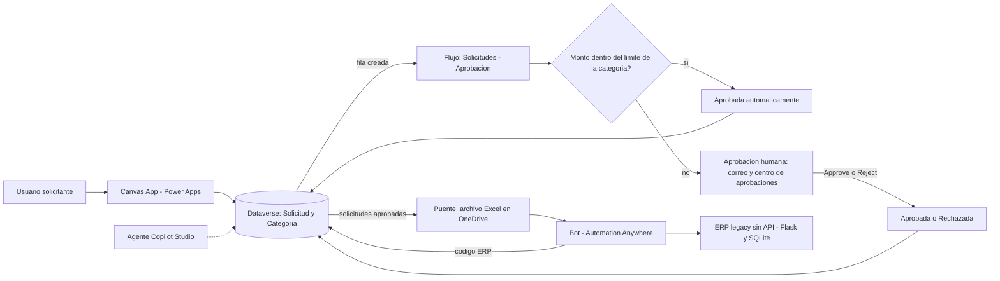
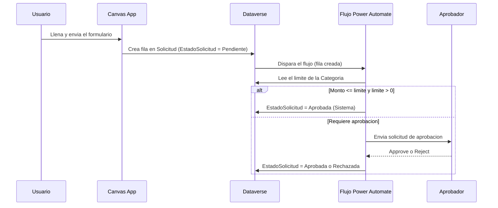
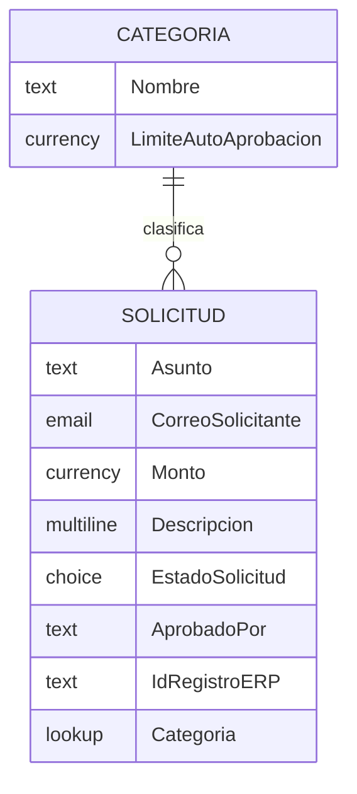

# Gestor de Solicitudes con Aprobación y RPA

Solución de automatización de punta a punta para el reembolso de gastos: un usuario registra una solicitud en una
aplicación **Power Apps**, un flujo de **Power Automate** decide si se aprueba sola o si requiere aprobación humana, y un
bot de **Automation Anywhere** registra las solicitudes aprobadas en un sistema contable que no tiene API.

> **Proyecto de portafolio con datos ficticios.** Todo el contenido (categorías, montos, correos, sistema contable) es
> simulado. No usa ni refleja información de ninguna organización real.

---

## 1. Idea del proyecto

### El problema
En muchas organizaciones los reembolsos de gastos siguen un proceso fragmentado:

1. El empleado envía la solicitud por correo o en una hoja de cálculo.
2. Alguien revisa a mano si el monto está dentro de lo permitido para esa categoría.
3. Un aprobador responde por correo.
4. Otra persona digita la solicitud aprobada en el sistema contable, que a menudo es un sistema antiguo **sin API**.

El resultado es lento, propenso a errores de digitación y difícil de auditar.

### La solución
Un proceso automatizado con responsabilidades claras:

| Etapa | Qué hace | Herramienta |
|---|---|---|
| Captura | Formulario validado para registrar la solicitud | Power Apps (Canvas App) |
| Almacenamiento | Datos estructurados y relacionados | Dataverse |
| Decisión | Aprueba sola si el monto cabe en el límite de la categoría; si no, pide aprobación | Power Automate |
| Aprobación humana | Notificación con botones Aprobar / Rechazar | Power Automate Approvals (correo y centro de aprobaciones) |
| Registro contable | Digita la solicitud aprobada en un sistema sin API | Automation Anywhere (RPA) |
| Consulta | Agente conversacional para consultar el estado de una solicitud | Copilot Studio |
| Análisis | Consultas SQL de reportes y optimización con índices | SQL |

### Qué busca demostrar
- Diseño de una solución **low-code end-to-end** alineada a una necesidad de negocio.
- Modelado de datos relacional en Dataverse (tablas, relación, columnas de elección).
- Automatización con reglas de negocio, aprobaciones y manejo de resultados.
- Uso **justificado** de RPA: solo donde no hay otra forma de integrarse.
- SQL intermedio-avanzado (CTE, funciones de ventana, índices y planes de ejecución).
- Buenas prácticas: solución versionable, pruebas, documentación y trazabilidad.

---

## 2. Arquitectura

### Vista general



Las líneas continuas están implementadas y probadas. La línea punteada del agente de Copilot Studio está configurada, pero sin prueba en vivo (ver fase 8 en la sección 5).

### Flujo de la decisión



### Modelo de datos (Dataverse)



- `Solicitud` tiene una columna de búsqueda (llave foránea) hacia `Categoria`: muchas solicitudes pertenecen a una categoría.
- `EstadoSolicitud` es una columna de elección: Pendiente, Aprobada, Rechazada, Registrada, Error.
- `LimiteAutoAprobacion = 0` significa que esa categoría **siempre** requiere aprobación humana.

Categorías de ejemplo (montos ficticios en colones):

| Categoría | Límite de aprobación automática |
|---|---|
| Alimentación | 25 000 |
| Transporte | 40 000 |
| Hospedaje | 100 000 |
| Capacitación | 0 (siempre requiere aprobación) |

### Regla de negocio

```
Aprobación automática  <=>  Monto <= LimiteAutoAprobacion  Y  LimiteAutoAprobacion > 0
En cualquier otro caso  =>  aprobación humana
```

---

## 3. Herramientas y tecnologías

| Capa | Tecnología | Para qué se usa |
|---|---|---|
| Interfaz | Power Apps (Canvas App) | Formulario de solicitud con validaciones |
| Datos | Microsoft Dataverse | Tablas relacionadas, columnas de elección y búsqueda |
| Automatización | Power Automate (flujo de nube) | Disparador por fila nueva, condiciones, aprobaciones y actualización de estado |
| Aprobaciones | Power Automate Approvals | Aprobar/Rechazar por correo o desde el centro de aprobaciones |
| RPA | Automation Anywhere (Community Edition) | Bot que opera la interfaz web del ERP |
| Agente | Microsoft Copilot Studio | Consulta conversacional del estado de una solicitud |
| Sistema legado simulado | Python, Flask, SQLite | ERP sin API que sirve de destino al bot |
| Análisis | SQL (SQLite, portable a PostgreSQL/MySQL) | CTE, funciones de ventana, índices y `EXPLAIN` |
| Control de versiones | Git / GitHub | Código, scripts y solución exportada |
| Entorno | Power Apps Developer Plan | Entorno de desarrollo gratuito con Dataverse |

---

## 4. Decisiones de diseño y justificación

| Decisión | Alternativa descartada | Por qué |
|---|---|---|
| Dataverse como almacén | Lista de SharePoint, Excel | Permite relaciones reales entre tablas, tipos de datos fuertes (moneda, elección) y es la base natural de Power Platform |
| Categoría en tabla aparte | Texto libre en cada solicitud | Evita errores de escritura y permite cambiar el límite de una categoría en un solo lugar |
| Límite 0 = siempre aprobar | Campo adicional "requiere aprobación" | Una sola columna expresa ambas reglas y la condición del flujo se mantiene simple |
| Disparador "al crear" la fila | "Al crear o modificar" | Si se disparara al modificar, el propio flujo se volvería a ejecutar cada vez que actualiza el estado |
| Estado como columna de elección | Texto | Valores controlados, sin variantes de escritura, y filtrables |
| RPA solo para el ERP | RPA para todo el proceso | RPA es frágil frente a cambios de interfaz: se reserva para donde no existe API. El resto se resuelve con conectores nativos |
| ERP sin API a propósito | Exponer una API REST | Reproduce el caso real que justifica un bot |
| `id_solicitud` único en el ERP | Permitir duplicados | Hace el registro **idempotente**: si el bot se reejecuta, el ERP rechaza el duplicado y el bot sabe qué hacer |
| Puente por archivo Excel en OneDrive | Llamar al bot por la API del Control Room | En el menú de la Community Edition utilizada no se encontró acceso a claves de API ni a colas de trabajo, por lo que se eligió un puente por archivo. En un entorno empresarial se usaría la cola de trabajo y la API |
| Solución de Power Platform | Objetos sueltos en el entorno | Permite exportar, versionar y mover el proyecto entre entornos |
| SQLite para el ERP | PostgreSQL/MySQL | Corre sin instalar nada. Las consultas usan SQL estándar y se portan cambiando solo las funciones de fecha |

---

## 5. Fases y estado

| Fase | Contenido | Estado |
|---|---|---|
| 1. Entorno | Developer Plan, Dataverse y Control Room de Automation Anywhere con agente instalado y dispositivo conectado | Completada |
| 2. Modelo de datos | Tablas `Categoria` y `Solicitud`, relación y datos de ejemplo, dentro de una solución | Completada |
| 3. Aplicación | Canvas App con formulario de nueva solicitud y confirmación | Completada |
| 4. Flujo de aprobación | Aprobación automática y rama de aprobación humana con actualización de estado | Completada (ver pruebas) |
| 5. ERP legacy y SQL | ERP sin API en Flask y scripts SQL con análisis e índices | Completada |
| 6. Puente y bot RPA | El flujo escribe las solicitudes aprobadas en un Excel; el bot las registra en el ERP y devuelve el código | Completada (el bot se ejecuta bajo demanda) |
| 7. Devolución del resultado | Flujo que guarda `IdRegistroERP` y pasa el estado a Registrada. Hay una versión programada cada 15 min, creada y desactivada | Completada |
| 8. Agente conversacional | Agente de Copilot Studio con la herramienta *Mostrar filas* de Dataverse sobre la tabla Solicitud | Configurada; sin prueba en vivo porque el entorno educativo no tiene créditos de Copilot Studio |
| 9. Cierre | Solución exportada, capturas y documentación del bot | Completada (video demostrativo pendiente) |

### Pruebas realizadas

| Caso | Resultado esperado | Resultado |
|---|---|---|
| Alimentación, 12 000 (límite 25 000) | Aprobada automáticamente | Correcto |
| Capacitación, 30 000 (límite 0) → Aprobar | Pasa a Aprobada, `AprobadoPor` = Aprobación manual | Correcto |
| Capacitación → Rechazar | Pasa a Rechazada | Correcto |
| Bot: filas aprobadas sin registrar | Registra en el ERP, escribe el código y marca `Registrado` en el Excel | Correcto |
| Fila nueva: Taxi aeropuerto (900) | ERP-000003 y en Dataverse pasa a Registrada | Correcto |
| Bot: se reejecuta con filas ya registradas | Las omite (idempotencia por `EstadoRPA`) | Correcto |
| Flujo de sincronización programado | Ejecución manual de prueba en verde | Correcto |
| ERP: registro válido | Código `ERP-000001` | Correcto |
| ERP: mismo `id_solicitud` dos veces | Rechazo por duplicado | Correcto |
| ERP: validaciones (correo, monto, categoría) | Mensajes de error | Correcto (pruebas automáticas) |

---

## 6. El sistema contable simulado (ERP legacy)

Aplicación web en Flask con login, formulario de registro y listado. **No expone API**: solo tiene interfaz, para justificar la
automatización con RPA. Cada elemento tiene un `id` estable que el bot usa como selector.

| Pantalla | Ruta | Elementos |
|---|---|---|
| Login | `/login` | `username`, `password`, `btn-login` |
| Nuevo registro | `/nuevo` | `id_solicitud`, `solicitante_email`, `categoria`, `monto`, `descripcion`, `btn-guardar` |
| Confirmación | `/registro/<codigo>` | `codigo-registro`, `mensaje-ok` |
| Errores | `/nuevo` | `mensaje-error` |

Para ejecutarlo, consulta el [README de `erp-legacy`](erp-legacy/README.md).

---

## 7. SQL: análisis y optimización

Sobre una tabla de 5 000 registros de prueba (datos ficticios generados con una semilla reproducible) se resolvieron:

- Gasto mensual por categoría (`GROUP BY`).
- Top 3 solicitantes por categoría (CTE con `RANK() OVER (PARTITION BY ...)`).
- Gasto acumulado mes a mes (`SUM() OVER`).
- Variación porcentual contra el mes anterior (`LAG`).
- Registros por encima del promedio de su categoría (`JOIN` con CTE).

**Optimización con índice.** Con `explain_demo.py` se compara el plan de ejecución antes y después de crear un índice compuesto
`(categoria, fecha_registro)`: el plan pasa de recorrer toda la tabla (`SCAN registros`) a una búsqueda por índice
(`SEARCH ... USING INDEX`). El orden de columnas pone primero la de igualdad (`categoria`) y luego la de rango
(`fecha_registro`). Con un volumen tan pequeño la mejora de tiempo es modesta; lo relevante es el cambio de plan, que cobra
importancia al crecer los datos.

Los scripts están en `erp-legacy/sql/` y se ejecutan con `seed.py`, `run_analysis.py` y `explain_demo.py`.

---

## 8. Seguridad, gobernanza y buenas prácticas

- **Datos ficticios.** No se usan datos reales ni de ninguna organización.
- **Todo dentro de una solución** de Power Platform, para exportarla y llevarla a otro entorno sin perder dependencias.
- **Credenciales del ERP** de demostración. El bot lee la contraseña desde el *Credential Vault* de Automation Anywhere (paso 5 del bot), por lo que no queda escrita dentro del código del bot.
- **Entorno de desarrollo separado.** El proyecto se construyó en un entorno propio de pruebas, no en el de ningún empleador.
- **Idempotencia.** El bot omite las filas ya marcadas `Registrado` y el ERP responde 409 ante un `id_solicitud` duplicado. El manejo explícito de errores del bot (estado `Error` con evidencia) queda como mejora futura.
- **Reglas de negocio centralizadas.** El límite vive en datos (`Categoria`), no escrito dentro del flujo.

---

## 9. Limitaciones conocidas y mejoras futuras

- El puente con el bot es por archivo, no por API, por las limitaciones de la edición gratuita utilizada.
- El correo del solicitante se escribe a mano en el formulario; lo ideal es tomarlo del usuario autenticado.
- Hay una sola ruta de aprobación (un aprobador). Una versión real tendría aprobadores por categoría o por jerarquía.
- No hay adjuntos de comprobantes.
- El bot no maneja aún el caso de error del ERP (por ejemplo, un 409): hoy omite las filas ya registradas, pero no marca `Error` con evidencia.
- El agente de Copilot Studio no se pudo probar en vivo por falta de créditos en el entorno educativo.
- Mejoras posibles: integrar `Environment variables` para el correo del aprobador, agregar un panel de seguimiento y migrar el ERP simulado a PostgreSQL.

---

## 10. Estructura del repositorio

```
gestor-solicitudes-rpa/
├── README.md             Este documento
├── erp-legacy/           ERP sin API (Flask) y scripts SQL
├── powerplatform/        Solución exportada (Power Apps, Dataverse, flujos)
├── rpa-bot/              Descripción paso a paso del bot (la edición Community no exporta)
└── docs/                 Capturas, diagramas y video
```

---

## 11. Capturas

| Captura | Qué muestra |
|---|---|
| `docs/img/01-modelo-dataverse.png` | Tablas `Categoria` y `Solicitud` con su relación |
| `docs/img/02-power-apps.png` | Formulario de nueva solicitud |
| `docs/img/03a-flujo-aprobacion-inicio.png` y `03b-flujo-aprobacion-ramas.png` | Flujo de aprobación con sus ramas |
| `docs/img/04-aprobacion-correo.png` | Correo de aprobación |
| `docs/img/05-erp.png` | Registros creados en el ERP |
| `docs/img/06a` a `06d` | Bot de Automation Anywhere, completo |
| `docs/img/07-excel.png` | Excel puente con `CodigoERP` y `EstadoRPA` |
| `docs/img/08-flujo-sync.png` y `08b-flujo-sync-programado.png` | Flujos que devuelven el código a Dataverse |
| `docs/img/09-dataverse-registrada.png` | Solicitudes en estado Registrada con su código ERP |
| `docs/img/10-agente.png` | Agente de Copilot Studio con su herramienta de Dataverse |

---

## Autor

**Kendall Chinchilla Araya** · Ingeniero en Sistemas · Costa Rica
